# GRADE/GPA PLANNER — Digital Assignment 3
## Scaling and Securing the Application

| | |
|---|---|
| **Course** | BACSE344 – Cloud Infrastructure and Architecture |
| **Assignment** | Digital Assignment 3 – C1 Slot |
| **Student Name** | Sindhuja Bhaskar |
| **Register Number** | 25BCE5430 |
| **Date of Submission** | 30/10/2026 |
| **Repository** | https://github.com/sindhuja-bhaskar/grade-gpa (branch `assignment-3`) |
| **Application** | Grade/GPA Planner from Assignment 1 — Next.js 16 (UI + REST API), Prisma ORM 7, Auth.js v5, Prisma Postgres cloud database |

Every number in this report was measured on the application and is backed by a
raw output file in `docs/da3/evidence/` on the `assignment-3` branch.

---

# Question 1 — Scale the application

## 1(a) Peak-demand situation, hardest-hit API, three instances behind Nginx

**Peak-demand situation — results day.** The Grade/GPA Planner belongs to an
institute's students. On a normal day a few students record a CAT or quiz mark.
When end-semester results are published, every student in the institute signs
in within the same few minutes to see their official GPA and the CGPA it
produces, and to check what GPA they now need to reach their target CGPA.
Traffic jumps from a handful of requests per minute to thousands, for a few
hours, a few times a year.

**API hit hardest — `GET /api/cgpa`.** This is the one call every student makes
on results day. It is also the most expensive read in the application: it
authenticates the session (a database read, so sessions stay revocable), loads
every semester, subject and assessment the student owns, runs the calculation
engine for every subject, and computes CGPA, the CGPA progression and the
required-GPA plan for the student's target.

**Implementation.**

| Component | Name | Port(s) |
|---|---|---|
| Load balancer | `gradegpa-nginx` (`nginx:1.27-alpine`) | host `8080` → container `80` |
| Backend 1 | `gradegpa-backend-1` (image `gradegpa:hardened`) | `backend1:3000`, host `3001` |
| Backend 2 | `gradegpa-backend-2` | `backend2:3000`, host `3002` |
| Backend 3 | `gradegpa-backend-3` | `backend3:3000`, host `3003` |
| Database | Prisma Postgres — the existing cloud database from Assignment 1 | `db.prisma.io:5432`, TLS |

* `docker-compose.scale.yml` defines the three backends and Nginx. All three
  replicas read `DATABASE_URL` and `AUTH_SECRET` from `.env` at run time, so
  no secret is baked into the image.
* `deploy/nginx/lb-3.conf` is the Nginx configuration: an `upstream` block of the
  three replicas, round-robin, with a shared-memory `zone` so all Nginx worker
  processes share one rotation.
* `GET /api/health` (new, public, no database access) returns the hostname of the
  container that answered. Nginx also adds an `X-Upstream` response header and
  logs `upstream=<address>` for every request.
* The replicas are **stateless**. Sessions are rows in the cloud database and all
  replicas share `AUTH_SECRET`, so a student who signed in through one replica is
  signed in on all of them. This is what makes horizontal scaling possible
  without sticky sessions.

**Evidence that requests are distributed across all three instances.**

Six consecutive calls to `/api/health` through Nginx (`q1a-health-round-robin.txt`):

```
{"status":"ok","instance":"backend1"}
{"status":"ok","instance":"backend2"}
{"status":"ok","instance":"backend3"}
{"status":"ok","instance":"backend1"}
{"status":"ok","instance":"backend2"}
{"status":"ok","instance":"backend3"}
```

Nginx access log for the 3-instance load test of `/api/cgpa`
(`q1a-distribution-3-instances.txt`):

| Container | Address | Requests served |
|---|---|---|
| gradegpa-backend-1 | 172.18.0.3:3000 | 336 |
| gradegpa-backend-3 | 172.18.0.4:3000 | 335 |
| gradegpa-backend-2 | 172.18.0.5:3000 | 335 |

> **Problem found and fixed while doing this part.** The first configuration had
> no `zone` directive. Nginx runs one worker process per CPU (10 here), and each
> worker kept its own round-robin pointer, so the first request each worker
> handled went to `backend1`: a short series of curl calls showed
> `backend1` six times in a row. Adding `zone gradegpa_backend 64k;` makes
> all workers share one rotation and one failure count. After that the
> distribution is exactly even, as shown above.

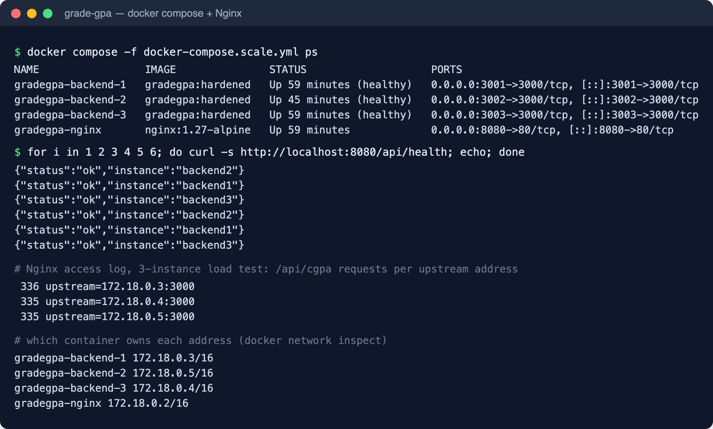

*Figure 1 — The four containers running, six consecutive requests through
Nginx rotating across the three backends, and the per-replica request counts
from the 3-instance load test.*

## 1(b) Load test — 1 instance vs 3 instances

**Tool and settings (identical for both runs):** Apache Bench 2.3,
`ab -n 1000 -c 50 -s 60 -C "<session cookie>" http://127.0.0.1:8080/api/cgpa`.
That is 1,000 authenticated requests, 50 concurrent, through the same Nginx and
against the same cloud database. For the single-instance run Nginx used
`deploy/nginx/lb-1.conf` (upstream = `backend1` only) and the other two
containers were stopped. The only thing that changed between runs was the number
of replicas.

| Metric | 1 instance | 3 instances | Change |
|---|---|---|---|
| Requests per second (mean) | **3.19** | **9.27** | **2.91× higher** |
| Average response time (ab "time per request", mean) | **15,693 ms** | **5,394 ms** | **65.6 % lower** |
| Median (50 %) response time | 15,060 ms | 5,062 ms | 66.4 % lower |
| 95th percentile | 18,568 ms | 8,909 ms | 52.0 % lower |
| 99th percentile | 21,230 ms | 11,870 ms | 44.1 % lower |
| Total time for 1,000 requests | 313.9 s | 107.9 s | 2.91× faster |
| Failed requests | 0 | 0 | — |

Raw output: `q1b-ab-1-instance.txt`, `q1b-ab-3-instances.txt`.

**Improvement and why it is close to 3×.** A single `/api/cgpa` request takes
about 1.2 s when the system is idle. Almost all of that is several sequential
round trips to the cloud database, not CPU time. Each replica has its own
database connection pool of at most 5 connections (`DATABASE_POOL_MAX`), so one
instance can work on only about five requests at a time while the other 45
wait in its queue, which is why the average is 15.7 s. Three replicas bring
three pools, so 15 requests progress at once and throughput rises almost exactly
threefold. The improvement stays slightly under 3× because all three replicas
share one database server and one network link to it. That shared database is
the next bottleneck, which part (d) addresses.

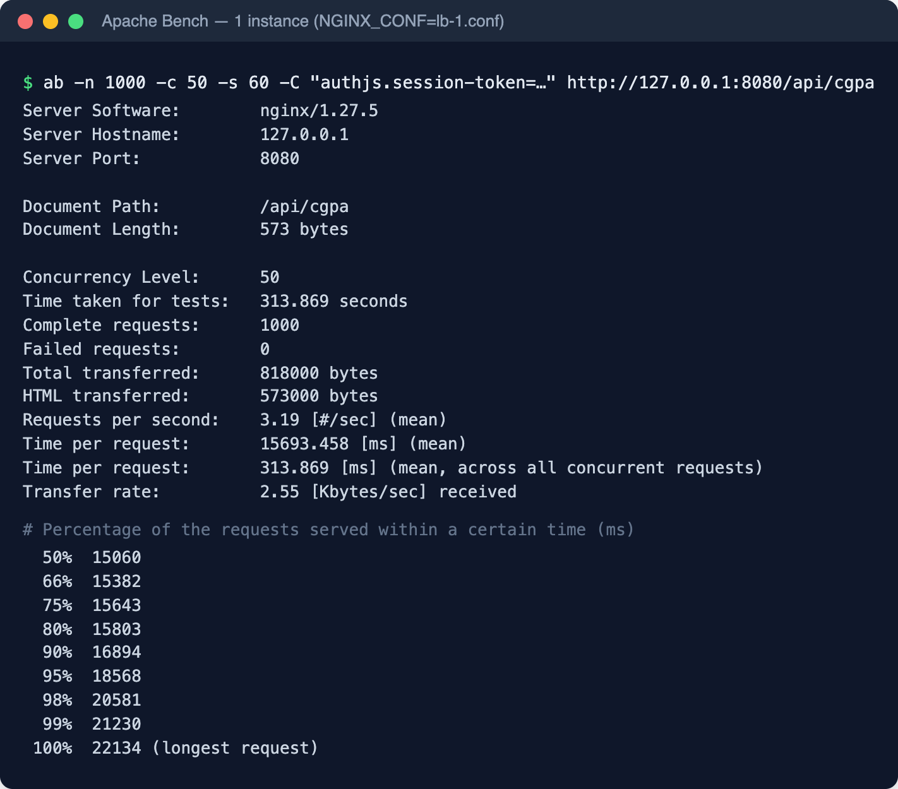

*Figure 2 — Apache Bench against one instance: 3.19 requests/s, 15,693 ms mean.*

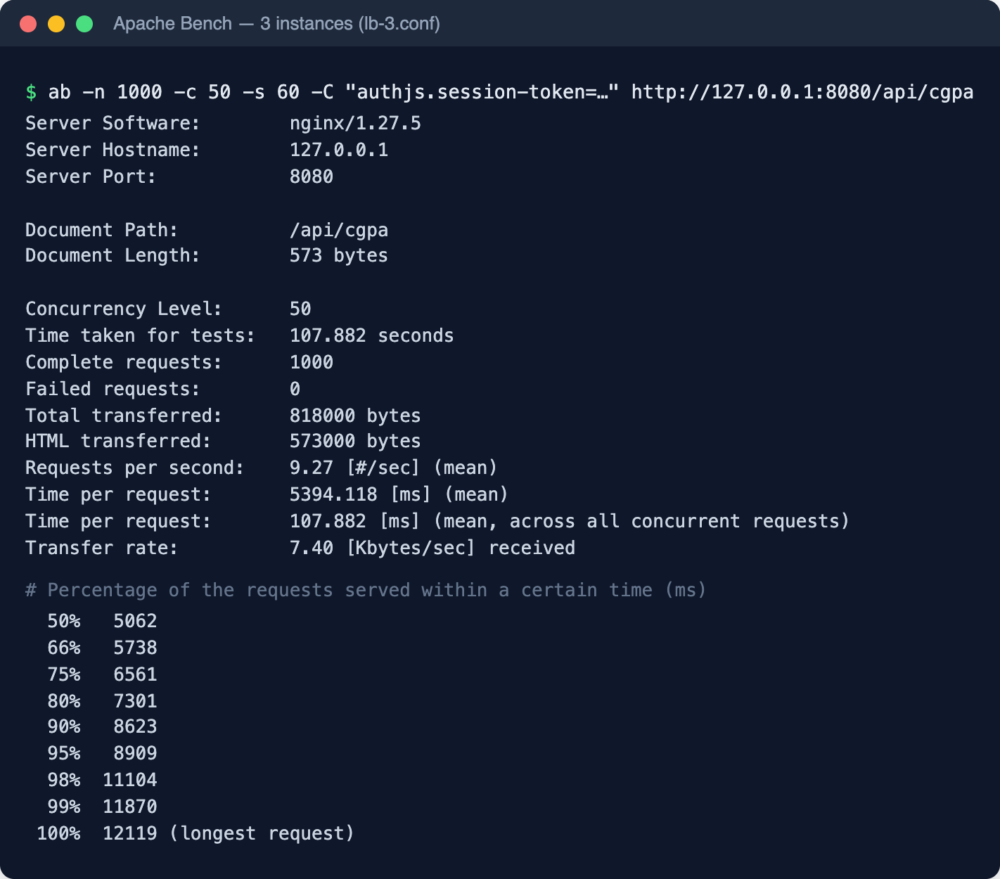

*Figure 3 — The same test against three instances: 9.27 requests/s, 5,394 ms mean.*

## 1(c) Stopping an instance during the load test

**Method.** The same load test (`ab -n 1000 -c 50` on `/api/cgpa`) was started
against three replicas, and `docker stop gradegpa-backend-2` was run 20 seconds
in, while requests were in flight. The test was run twice: once with a naive
Nginx configuration and once with the fixed one.

**Before — `deploy/nginx/lb-3-naive.conf`.** Plain round-robin with
`proxy_next_upstream off`. A request that Nginx sent to the stopped container
is returned to the student as an error.

**After — `deploy/nginx/lb-3.conf`.**

```nginx
upstream gradegpa_backend {
    zone gradegpa_backend 64k;
    server backend1:3000 max_fails=1 fail_timeout=10s;
    server backend2:3000 max_fails=1 fail_timeout=10s;
    server backend3:3000 max_fails=1 fail_timeout=10s;
    keepalive 32;
}
...
proxy_connect_timeout 2s;
proxy_next_upstream error timeout http_502 http_503 http_504;
proxy_next_upstream_tries 3;
proxy_next_upstream_timeout 10s;
```

* `proxy_next_upstream` replays a request that failed on a dead or dying replica
  on the next replica before any response reaches the student. Failures covered:
  refused connection, connection reset mid-response, timeout, 502/503/504.
* `max_fails=1 fail_timeout=10s` takes a failed replica out of rotation after
  one error, and the shared `zone` makes every worker know about it at once.
* `proxy_connect_timeout 2s` (default 60 s) means a vanished container costs a
  2-second retry, not a hung request.
* POST/PUT/DELETE are deliberately **not** retried (no `non_idempotent` flag).
  Replaying a mark entry on a second replica could apply it twice. Only safe,
  idempotent requests are replayed.

**Result.**

| Run (1,000 requests, c = 50, backend-2 stopped at t ≈ 20 s) | Successful (HTTP 200) | Failed | Retried transparently on another replica |
|---|---|---|---|
| **Before** — naive config | 991 | **9** (HTTP 502 Bad Gateway) | 0 |
| **After** — failover config | 1,000 | **0** | 25 |

Raw output: `q1c-ab-naive-stop-one.txt`, `q1c-naive-status-codes.txt`,
`q1c-naive-nginx-errors.txt`, `q1c-ab-resilient-stop-one.txt`,
`q1c-resilient-status-codes.txt`.

In the "after" run, the Nginx error log shows what was absorbed. 15 in-flight
requests had their connection closed by the stopping container
(`upstream prematurely closed connection`), and the rest were connect timeouts
when Nginx re-tried the dead replica every 10 s. Each one appears in the
access log with two upstreams, for example
`upstream=172.18.0.5:3000, 172.18.0.4:3000 ... 200`: the first replica failed
and the second one answered. The student received HTTP 200 every time.

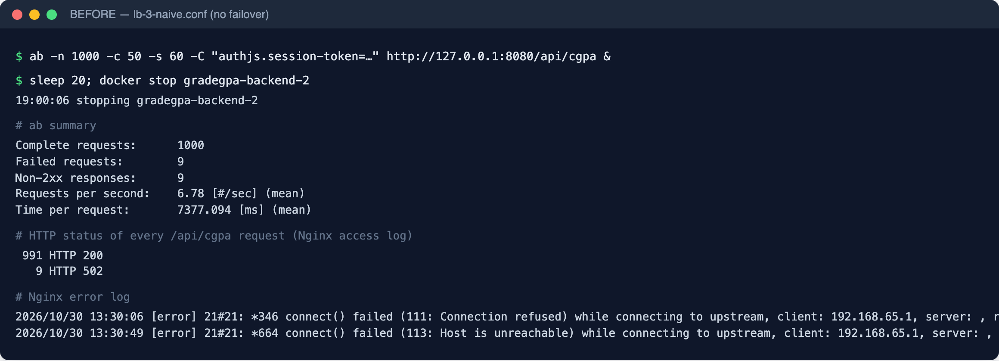

*Figure 4 — Before: backend-2 stopped during the load test with the naive
configuration. 9 requests fail with HTTP 502.*

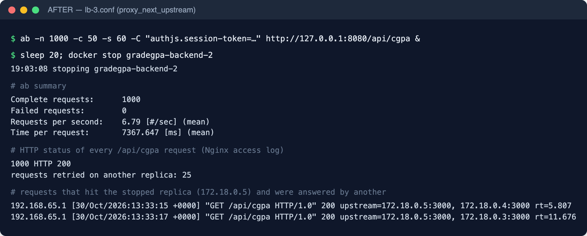

*Figure 5 — After: the same test with `lb-3.conf`. 0 requests fail; the
access-log lines show requests that hit the stopped replica (172.18.0.5) and
were answered by another one.*

## 1(d) Architecture diagram and cloud bursting

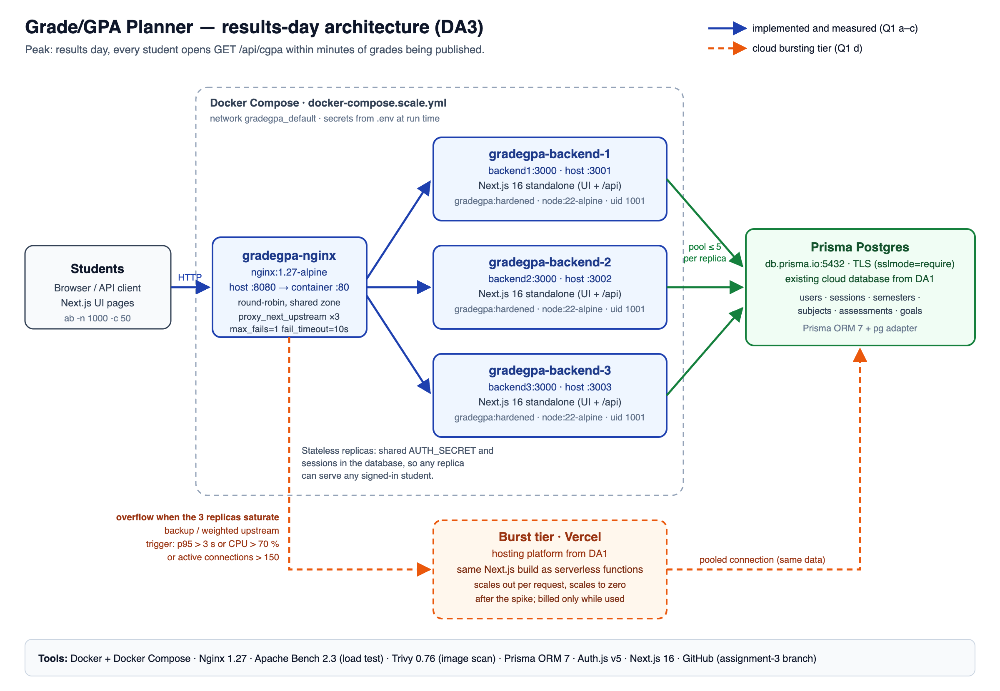

*(Source: `docs/da3/architecture.svg`. Blue = implemented and measured in parts
a–c; orange dashed = the cloud-bursting component.)*

**Chosen component: cloud bursting to Vercel.**

The three Docker replicas behind Nginx form the **base tier**, sized for a normal
term. Vercel, the hosting platform from Assignment 1
(`docs/DEPLOY_VERCEL.md`), runs the same Next.js build as serverless
functions and forms the **burst tier**.

**How it handles results day.**

1. Normally Nginx sends all traffic to `backend1–3`. The burst tier costs
   nothing because it scales to zero.
2. When results are published, `/api/cgpa` traffic exceeds what three replicas
   serve well. Part (b) measured 9.27 req/s with a 5.4 s average at 50
   concurrent students. Nginx overflows the extra traffic to Vercel. In Nginx
   terms that is a `backup` or low-`weight` server in the same upstream, or a
   weighted DNS record. The trigger is p95 latency above 3 s, CPU above 70 %, or
   more than 150 active connections.
3. Vercel starts as many function instances as the extra requests need, in
   seconds, and they read the **same** cloud database. A student sees the same
   GPA whichever tier answers.
4. When the spike passes, overflow stops and Vercel scales back to zero. The
   institute pays for extra capacity only during the hours it is used.

**What makes this possible in this application.** The application tier holds no
state. Sessions live in the database and are signed with a shared `AUTH_SECRET`,
so a student signed in on a Docker replica stays signed in when a request bursts
to Vercel. No session migration and no sticky routing are needed.

**Why cloud bursting rather than edge/fog computing, for this domain.**

* The demand is a **short, predictable, institution-wide spike**: results day
  and registration a few times a year. Paying for triple capacity all year
  would be wasted. Bursting buys capacity only for those hours, which is
  exactly the problem it was designed for.
* Edge/fog computing suits **latency-sensitive or data-heavy work near the
  source**, such as sensor data, video or factory machines. Here every response
  is computed from one student's own records in the central database. An edge
  node cannot answer `/api/cgpa` without going back to that database, and
  caching personal results at many edge locations would spread students'
  academic records across more places, which part 2(d) argues against.
* Students are in one region (the institute), so edge placement gains little
  latency.

**Limitation stated honestly.** Bursting multiplies the application tier, but
part (b) showed the database round trips dominate. During a burst the burst
tier must use a pooled connection with a small pool per function, and the
database plan's connection limit must be checked before results day.
Otherwise the bottleneck moves to the database.

---

# Question 2 — Secure the application

## 2(a) Most sensitive data, and salted password hashes

**Most sensitive data stored.** In order of sensitivity:

1. **Student academic records**: every assessment mark, final marks, grades,
   GPA and CGPA (`assessments`, `subjects`, `semesters`). A student's marks are
   personal data. Disclosure harms privacy, and alteration harms academic
   integrity: a changed mark changes a grade, a GPA and possibly a
   scholarship or placement decision.
2. **Credentials and authentication secrets**: password hashes, session tokens
   (`sessions`) and, from part (b), TOTP secrets.
3. **Identity**: name and email (`users`), which link the records to a real
   student.

**Password storage.** Passwords are stored as **bcrypt** hashes with cost factor
12 (`src/lib/auth/password.ts`). bcrypt generates a random 16-byte **salt** for
every hash and embeds it in the stored value (`$2b$12$<22-char salt><31-char
hash>`), so two students with the same password get different hashes, and
precomputed rainbow tables are useless. Cost 12 means about 4,096 rounds of the
key schedule, so each guess costs an attacker real time.

The application has written only bcrypt hashes since Assignment 1. For this
assignment, `scripts/hash-plaintext-passwords.ts` was added for rows that
reach the database some other way, such as a legacy import or a manual
`INSERT`. It finds every password that is not a bcrypt hash and replaces it with
one. It is idempotent and has a `--dry-run` mode. To demonstrate it, a
legacy-import account with a plain-text password was written
(`scripts/da3-demo-accounts.ts legacy`) and the migration was then run.

**Before** (`q2a-before.txt`):

```
        email        |  role   |                         passwordHash
---------------------+---------+--------------------------------------------------------------
 advisor@example.com | ADVISOR | $2b$12$8KUlFGn/lbCqZdxBnx.ifOSgczIpScpdv8FhUZomJ4a1MiFs6yY1K
 legacy@example.com  | STUDENT | legacy123
 student@example.com | STUDENT | $2b$12$aIa5qrCZXlMxGQ1wIovMmuH90dbgH2N6Qdpcp7GJR8YIgTXuLpyr.
```

**Migration run:** `3 account(s) with a password; 1 stored in plain text. hashed: legacy@example.com`

**After** (`q2a-after.txt`):

```
        email        |  role   |                         passwordHash
---------------------+---------+--------------------------------------------------------------
 advisor@example.com | ADVISOR | $2b$12$8KUlFGn/lbCqZdxBnx.ifOSgczIpScpdv8FhUZomJ4a1MiFs6yY1K
 legacy@example.com  | STUDENT | $2b$12$vixsTHxukan0qqP6f5YHRe8m.OtxtNwSRFB8x8iZ./GbgQNoPFxmm
 student@example.com | STUDENT | $2b$12$aIa5qrCZXlMxGQ1wIovMmuH90dbgH2N6Qdpcp7GJR8YIgTXuLpyr.
```

A second run reports `0 stored in plain text`.

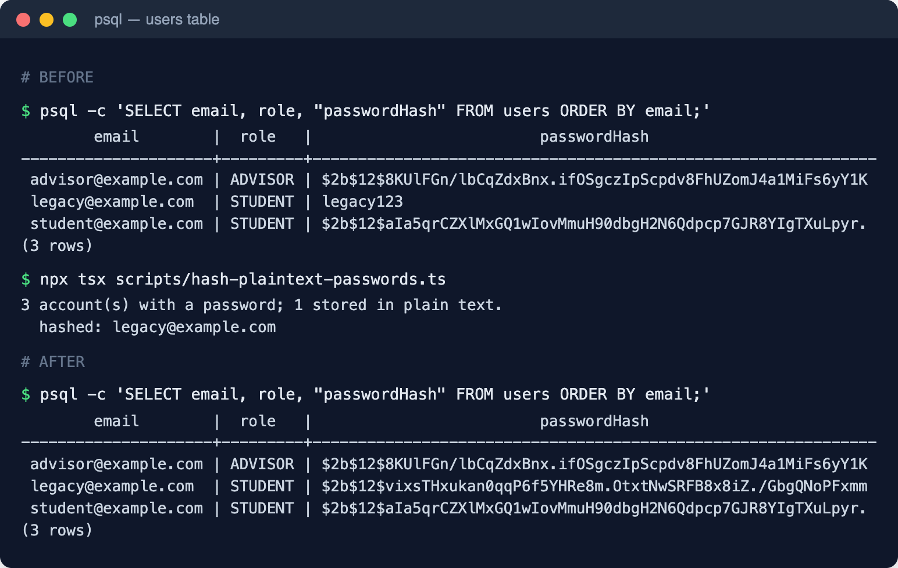

*Figure 6 — The `users` table before and after `hash-plaintext-passwords.ts`.
This run used a disposable PostgreSQL 16 database with the same schema and
migrations, so that a plain-text password was never written to the live cloud
database.*

## 2(b) Multi-factor authentication (TOTP) and role-restricted Update/Delete

### TOTP second factor

* **Algorithm.** RFC 6238 TOTP (HMAC-SHA1, 6 digits, 30-second step), the
  defaults Google Authenticator and Microsoft Authenticator use, implemented in
  `src/lib/auth/totp.ts` on Node's `crypto`. The unit tests check it against the
  official test vectors in RFC 4226 Appendix D and RFC 6238 Appendix B
  (`src/lib/auth/__tests__/totp.test.ts`).
* **Enrolment, in two steps** (`/dashboard/security` page and
  `POST/PUT/DELETE /api/auth/mfa`):
  1. *Set up authenticator* creates a 160-bit secret and shows it as a QR code
     (`otpauth://totp/Grade GPA Planner:<email>?secret=…`) for the app to scan.
  2. The student types the 6-digit code from the app, and only a correct code
     switches MFA on, so nobody can lock themselves out with a QR code they never
     scanned. Turning MFA off also requires a current code.
* **Sign-in.** When MFA is enabled, a correct password alone returns
  `401 MFA_REQUIRED`, and the login page then asks for the authenticator code.
  The check sits in `checkCredentials()` (`src/lib/auth/credentials.ts`), which
  Auth.js's `authorize()` calls. Both sign-in paths, the REST `/api/auth/login`
  and Auth.js's own `/api/auth/callback/credentials`, therefore enforce it, and
  neither can bypass the other.
* **Hardening beyond the basic requirement:**
  * **Replay protection.** The time step of the last accepted code is stored
    (`totpLastStep`), so each code works exactly once. A conditional update
    makes two simultaneous requests with the same code unable to both succeed.
  * **Secret encrypted at rest.** The TOTP secret is stored AES-256-GCM
    encrypted under a key derived from `AUTH_SECRET` with HKDF. A stolen
    database dump does not let anyone generate codes (`q2b-totp-secret-at-rest.txt`):
    `v1.2lozjx6zqz_GNNrx.E7dPpBczFLYY0d6hjQLGjA.GtXVXPFuOViF61B-ftdhsFILXzWYYrdaNM0OBGwo4Co`
  * **Clock drift.** ±1 step (±30 s) of drift is tolerated, but not more.
  * **Rate limiting.** The login endpoint's existing limit (10 attempts per
    minute per client) also bounds guessing of the 6-digit code.

### Role-based restriction of Update and Delete

The domain has two roles (new `Role` enum, migration
`20261030_roles_and_totp`):

| Role | Who | `records:read` | `records:write` (create, **update, delete**) |
|---|---|---|---|
| `STUDENT` | the student who owns the academic record | ✔ | ✔ (own records only) |
| `ADVISOR` | faculty advisor, read-only access | ✔ | ✘ → **403** |

* Every `PUT` and `DELETE` (and `POST`) on `/api/semesters`, `/api/subjects`,
  `/api/assessments` and `/api/goals` uses `withPermission("records:write", …)`
  (`src/lib/api/handler.ts`). The dashboard's Server Actions call the same
  `requirePermission`, so a form cannot do what the API refuses.
* The role is re-read from the database on every request, together with the
  session row, so demoting an account takes effect immediately.
* Status codes stay distinct: **401** for no or invalid session, **403** for
  a signed-in account whose role lacks the permission, and the ownership check
  still returns **403** for another student's record.

**Evidence** (`q2b-auth-demo.txt`, produced by `scripts/da3-auth-demo.ts`):

```
── 1. Update/Delete without a valid token ──
401  DELETE /api/subjects/any-id   no cookie     → UNAUTHORIZED: Authentication is required.
401  PUT    /api/subjects/any-id   no cookie     → UNAUTHORIZED: Authentication is required.
401  DELETE /api/subjects/any-id   forged cookie → UNAUTHORIZED: Authentication is required.

── 2. Enrol an authenticator (TOTP) ──
200  POST   /api/auth/mfa          start enrolment → ok
422  PUT    /api/auth/mfa          wrong code      → VALIDATION_ERROR: That code is not valid.
200  PUT    /api/auth/mfa          code from app   → ok

── 3. Sign-in now needs the second factor ──
401  POST   /api/auth/login        password only      → MFA_REQUIRED
401  POST   /api/auth/login        wrong code         → UNAUTHORIZED
200  POST   /api/auth/login        password + TOTP    → ok
401  POST   /api/auth/login        same code replayed → UNAUTHORIZED

── 4. Role check: STUDENT may update/delete own records ──
200  PUT    /api/subjects/{id}     rename own subject → ok
204  DELETE /api/semesters/{id}    delete it          → ok

── 5. Role check: ADVISOR is read-only ──
200  GET    /api/subjects          advisor read   → ok
403  PUT    /api/subjects/{id}     advisor update → FORBIDDEN: The advisor role is not permitted to modify academic records.
403  DELETE /api/subjects/{id}     advisor delete → FORBIDDEN: The advisor role is not permitted to modify academic records.
```

The same 21 status codes were reproduced against the final hardened Docker image.

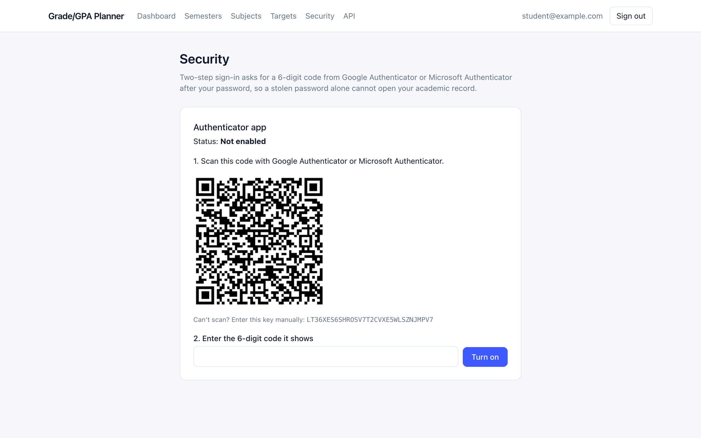

*Figure 7 — The Security page on the deployed site
(grade-gpa-git-assignment-3-sindhuja4.vercel.app): the QR code to scan with
Google or Microsoft Authenticator, and the key for manual entry.*

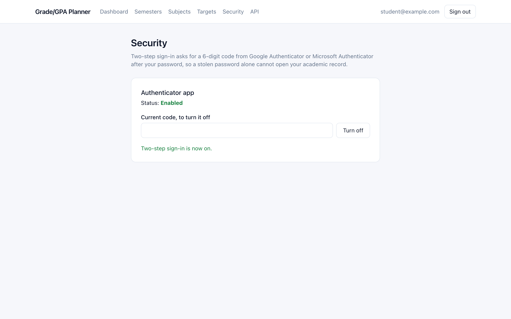

*Figure 8 — After the 6-digit code from the app is confirmed, two-step sign-in is on.*

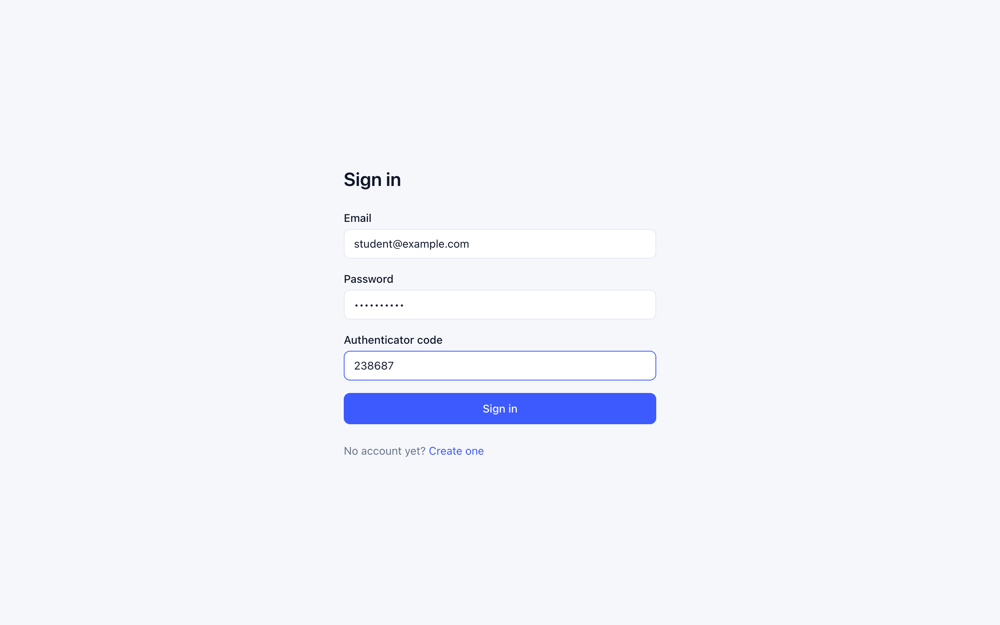

*Figure 9 — Signing in again: after the password, the site asks for the
authenticator code.*

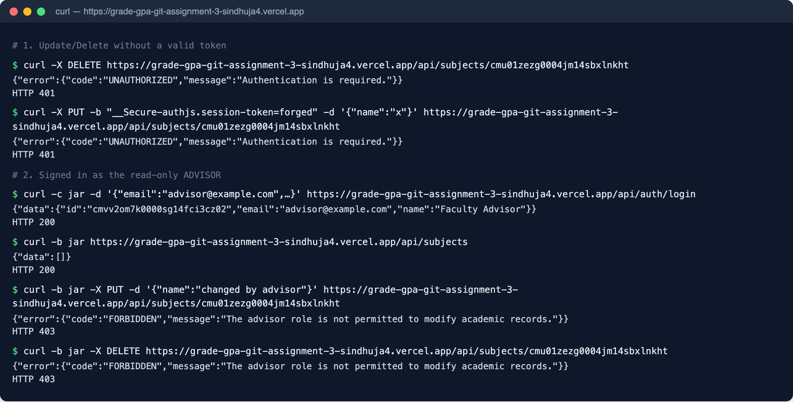

*Figure 10 — The deployed site's API: Update/Delete without a token, or with a
forged one, return 401; the signed-in ADVISOR can read but gets 403 on update
and delete.*

## 2(c) Container image scan with Trivy — before and after hardening

**Before — `Dockerfile.baseline`:** `FROM node:22` (full Debian 12), source
tree, all dev dependencies, runs `npm start` **as root**.

**After — `Dockerfile` (hardened):**

| Measure | How |
|---|---|
| Smaller base image | `node:22-alpine` instead of full Debian; `apk upgrade` at build time |
| Multi-stage build | compilers, dev dependencies and source code stay in the build stages |
| Only what runs is shipped | Next.js `output: "standalone"`: only the traced `node_modules` are copied |
| No package managers at runtime | npm, npx, corepack and yarn removed (they carry their own CVEs; the server never uses them) |
| **Non-root user** | `USER app` (uid 1001); app files stay root-owned and read-only to that user |
| No secrets in layers | `.dockerignore` excludes `.env`; secrets are supplied at run time |
| Health check | `HEALTHCHECK` against `/api/health` |

Scanned with **Trivy 0.76.1**:
`trivy image --scanners vuln --severity CRITICAL,HIGH <image>`.

| Image | Size | User | CRITICAL | HIGH |
|---|---|---|---|---|
| `gradegpa:baseline` (node:22, Debian 12) | 3.94 GB | root (uid 0) | **27** (21 OS + 6 Node.js) | **487** (463 OS + 24 Node.js) |
| `gradegpa:hardened` (alpine, non-root, standalone) | 343 MB | app (uid 1001) | **3** | **3** |
| `gradegpa:hardened` + Next.js 16.3.5 → 16.4.1 | 315 MB | app (uid 1001) | **0** | **0** |

Raw output: `q2c-trivy-baseline.txt`, `q2c-trivy-hardened.txt`,
`q2c-trivy-hardened-patched.txt`.

The base-image change removed every OS-level finding (484 → 0). The six findings
left after hardening were all in the application's own dependencies: `next`
16.3.5 (three critical remote-code-execution advisories in image optimisation,
`use cache` and `next/og`, plus a DoS and an SSRF) and `sharp` 0.35.4.
Upgrading to Next.js 16.4.1, which also brings `sharp` 0.35.5, cleared them.
This is the lesson of the exercise: a smaller base image removes the OS noise
so the findings that matter become visible, and they still have to be fixed by
patching dependencies.

Non-root verified inside the running container:

```
$ docker run --rm --entrypoint sh gradegpa:hardened -c 'id; which npm; touch /app/x'
uid=1001(app) gid=1001(app) groups=1001(app)
npm: not present
touch: /app/x: Permission denied
$ docker run --rm --entrypoint id gradegpa:baseline
uid=0(root) gid=0(root) groups=0(root)
```

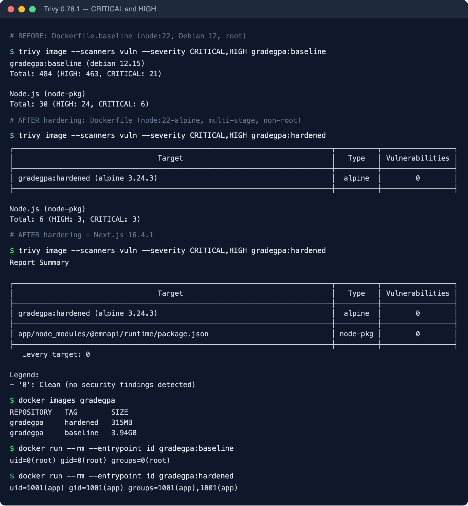

*Figure 11 — Trivy results for the baseline image, the hardened image, and the
hardened image after the Next.js upgrade; image sizes; the user each image
runs as.*

## 2(d) Threat agents, controls and regulation

| Threat agent | What they want / how | Control implemented | Regulatory requirement it meets |
|---|---|---|---|
| **1. External attacker (credential stuffing / account takeover).** Someone outside the institute replaying email-and-password pairs leaked from other sites, or phishing a student's password. | Sign in as the student to read their academic record, or change marks. | **TOTP multi-factor authentication** (2b): a stolen password alone gets only `MFA_REQUIRED`. Codes are single-use, the secret is encrypted at rest, and passwords are **salted bcrypt hashes** (2a), so a database leak does not reveal them. Login is rate-limited. | **GDPR Art. 32(1)**: implement "appropriate technical and organisational measures to ensure a level of security appropriate to the risk", including encryption and "the ability to ensure the ongoing confidentiality [and] integrity" of processing systems. |
| **2. Malicious insider: a peer student, or a staff account with read access.** A classmate, or someone with legitimate access, who tries to view or alter another student's marks (for example by calling `PUT /api/assessments/{id}` with another record's id). | Inflate their own grade, damage someone else's, or browse others' records. | **Role-based access**: the `ADVISOR` role is read-only, and update/delete need `records:write` (403 otherwise). **Ownership checks** on every request return 403 for another student's record. Sessions are server-side and revocable. Containers are non-root (2c) to limit what a compromised process could change. | **GDPR Art. 5(1)(f), "integrity and confidentiality"**: personal data must be "processed in a manner that ensures appropriate security … including protection against unauthorised or unlawful processing and against accidental loss, destruction or damage". **Art. 25**, data protection by design and by default: only the minimum access each role needs. |

**Why GDPR applies.** The application processes **personal data** about
identifiable natural persons: names, email addresses, and every mark, grade,
GPA and CGPA linked to them. HIPAA does not apply because no health data is
processed. GDPR applies whenever an institute offers the service to people in
the EU, including exchange students and EU-resident applicants. It is also the
benchmark for personal-data protection that India's **Digital Personal Data
Protection Act, 2023** follows, which governs an Indian institute
directly: it likewise requires "reasonable security safeguards to prevent
personal data breach" (s. 8(5)). The controls above satisfy both.

---

# Reproducing the results

```bash
git checkout assignment-3
npm ci && npm run typecheck && npm test && npm run lint   # 77 tests

# Q1 — scale (needs .env with DATABASE_URL and AUTH_SECRET)
docker compose -f docker-compose.scale.yml up -d --build
for i in 1 2 3 4 5 6; do curl -s localhost:8080/api/health; echo; done
curl -c jar.txt -H 'content-type: application/json' \
  -d '{"email":"student@example.com","password":"planner123"}' localhost:8080/api/auth/login
ab -n 1000 -c 50 -C "authjs.session-token=<value from jar.txt>" http://127.0.0.1:8080/api/cgpa
NGINX_CONF=lb-1.conf       docker compose -f docker-compose.scale.yml up -d --force-recreate nginx  # 1 replica
NGINX_CONF=lb-3-naive.conf docker compose -f docker-compose.scale.yml up -d --force-recreate nginx  # 1(c) before
docker stop gradegpa-backend-2                                                                      # during ab

# Q2
npx prisma migrate deploy
npx tsx scripts/da3-demo-accounts.ts advisor
npx tsx scripts/da3-demo-accounts.ts legacy && npx tsx scripts/hash-plaintext-passwords.ts
BASE_URL=http://localhost:8080 npx tsx scripts/da3-auth-demo.ts
docker build -f Dockerfile.baseline -t gradegpa:baseline .
docker build -t gradegpa:hardened .
trivy image --scanners vuln --severity CRITICAL,HIGH gradegpa:baseline
trivy image --scanners vuln --severity CRITICAL,HIGH gradegpa:hardened
```

# Files added or changed for this assignment

| File | Purpose |
|---|---|
| `docker-compose.scale.yml`, `deploy/nginx/*.conf` | Three replicas + Nginx; 1-replica, naive and failover configs |
| `Dockerfile`, `Dockerfile.baseline`, `.dockerignore` | Hardened image and the "before" image for the Trivy comparison |
| `src/app/api/health/route.ts` | Health probe that reports which replica answered |
| `src/lib/auth/totp.ts` (+ tests) | RFC 6238 TOTP, secret encryption at rest |
| `src/lib/auth/credentials.ts` | Password + TOTP check used by every sign-in path |
| `src/lib/auth/roles.ts` (+ tests), `src/lib/api/handler.ts` | Roles and `withPermission` |
| `src/lib/services/mfa.ts`, `src/app/api/auth/mfa/route.ts` | Authenticator enrolment API |
| `src/app/dashboard/security/*`, `src/app/(auth)/login/page.tsx` | Enrolment UI, code step at sign-in |
| `prisma/migrations/20261030_roles_and_totp` | `role`, `totpSecret`, `totpEnabledAt`, `totpLastStep` |
| `scripts/hash-plaintext-passwords.ts`, `scripts/da3-*.ts` | Password migration, demo accounts, auth walkthrough |
| `docs/da3/evidence/*` | Raw output behind every table in this report |
