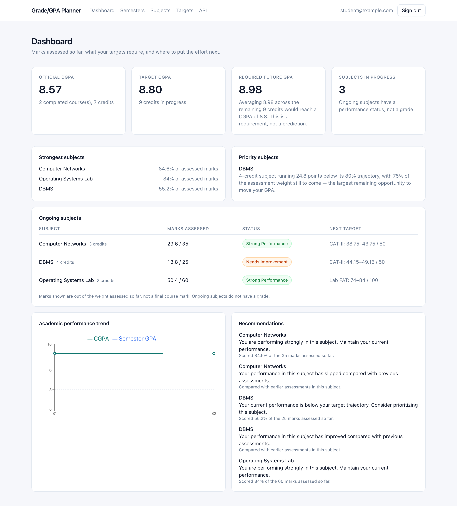
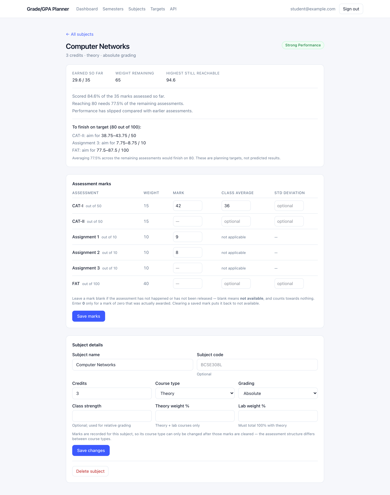
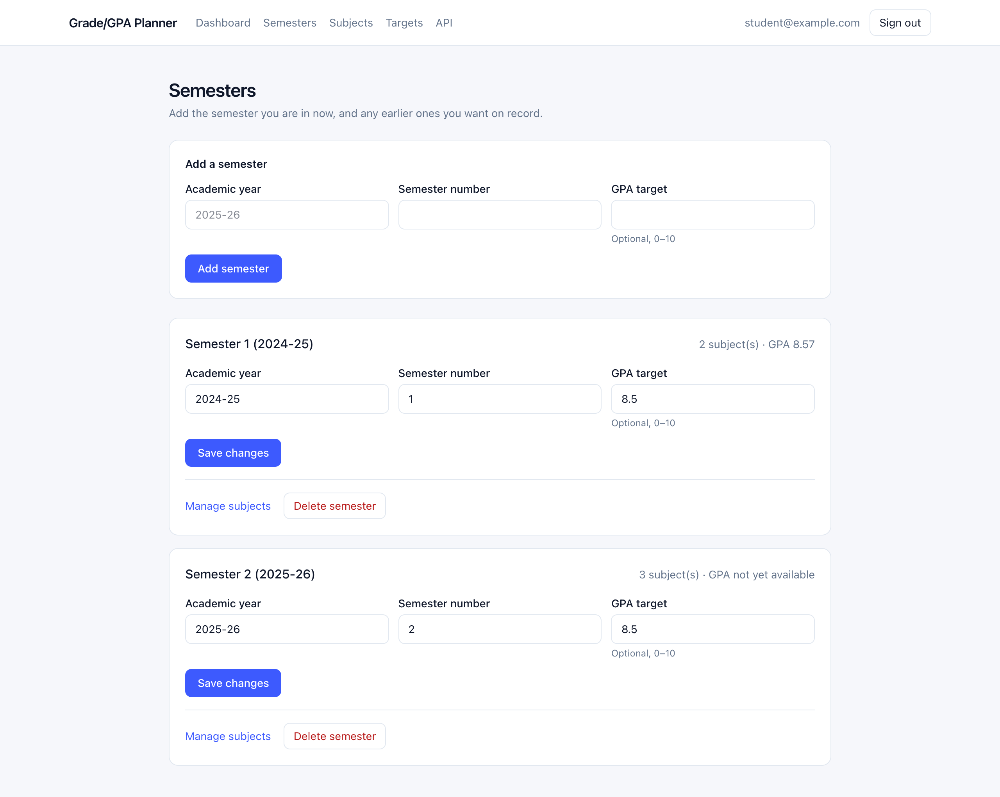
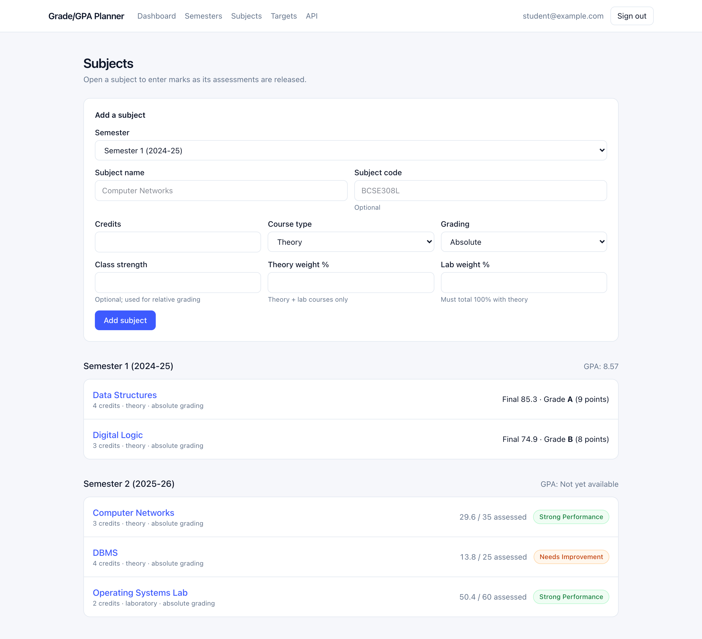
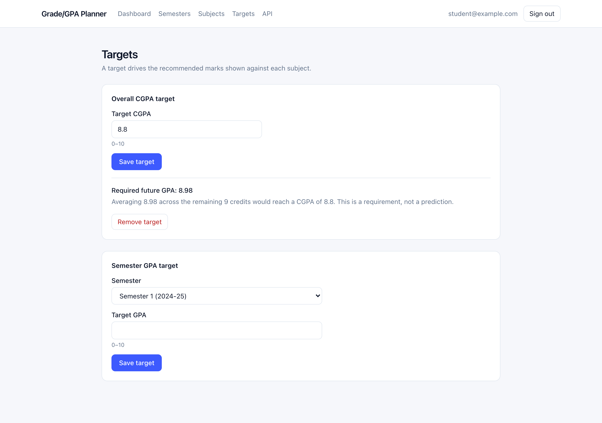
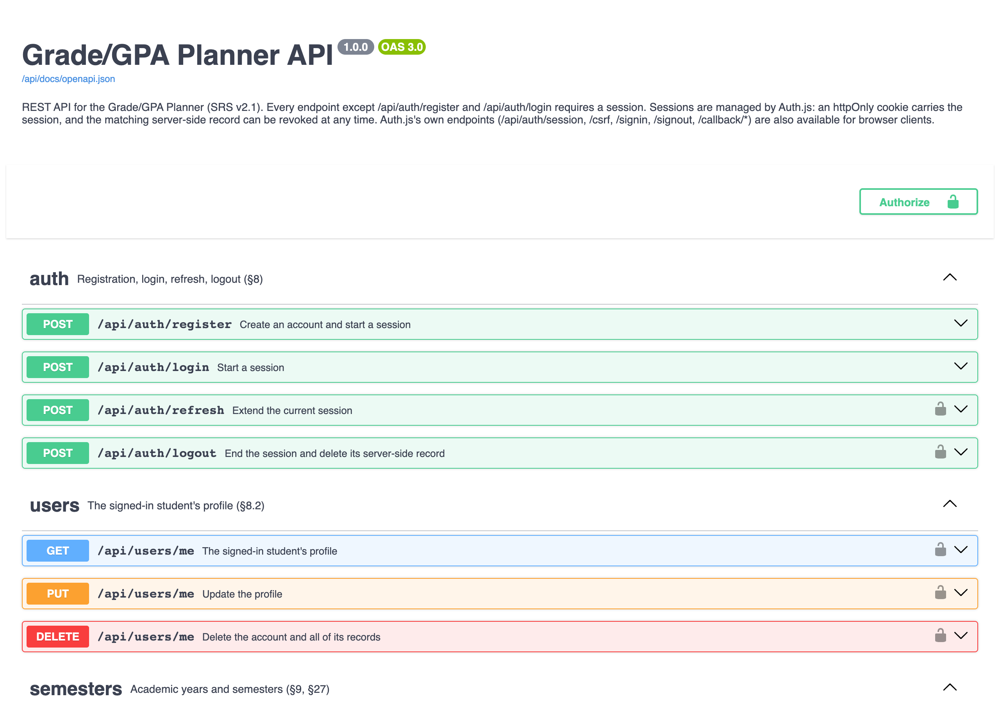
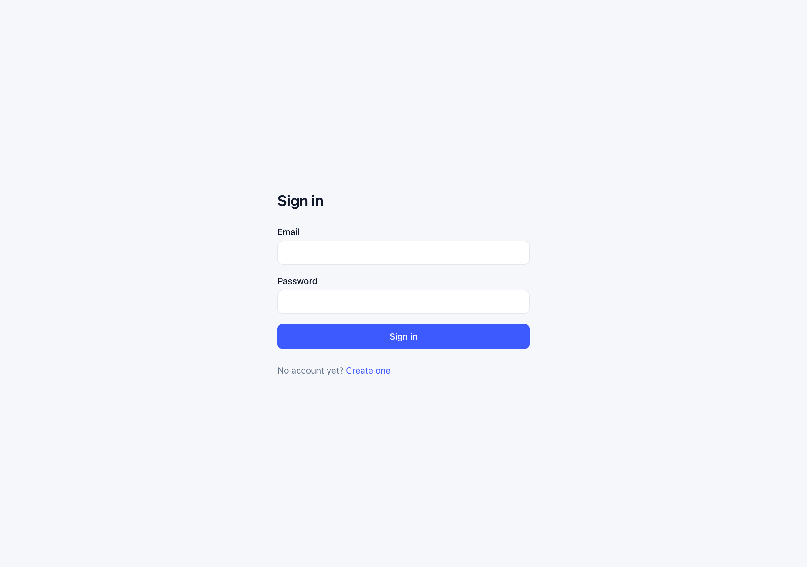

# GRADE/GPA PLANNER
## Personal Academic Performance & GPA Planning System

**Project Report**

| | |
|---|---|
| **Project Title** | Grade/GPA Planner — Personal Academic Performance & GPA Planning System |
| **Project Type** | Cloud-Based Web Application |
| **Course** | BACSE344 – Cloud Infrastructure and Architecture |
| **Assignment** | Digital Assignment – C1 Slot |
| **Faculty** | Dr. P. Anandan |
| **Student Name** | _[to be filled in]_ |
| **Register Number** | _[to be filled in]_ |
| **Date of Submission** | _[to be filled in]_ |
| **Report Version** | 1.0 |
| **Specification** | Software Requirements Specification v2.1 (`docs/reqs.md`) |

---

## Abstract

Students track academic marks across spreadsheets, notes and generic calculators.
None of these tools understand the structure of a university assessment scheme,
and all of them share a defect that quietly corrupts a student's picture of their
own standing: a mark that has not yet been released is treated as a zero.

The Grade/GPA Planner is a cloud-architected web application that models the
academic scheme itself — weighted components, course types, relative and absolute
grading — and keeps four things rigorously distinct: marks actually earned,
assessments not yet available, planning targets, and official grades. From
progressively entered marks it computes current standing, official GPA and CGPA
from completed courses only, the GPA required to reach a target CGPA, and the
marks required in remaining assessments, together with rule-based performance
categories and recommendations.

The system is implemented as a single full-stack Next.js 16 application in
TypeScript over a PostgreSQL database accessed through Prisma, with session
authentication via Auth.js and a calculation engine isolated as pure,
independently tested server-side modules. The engine carries 64 unit tests
covering the worked examples and boundary conditions of the specification, and
the complete create–read–update–delete surface has been exercised end to end
through both the REST API and an automated browser session.

---

## Table of Contents

1. [Introduction](#1-introduction)
2. [Problem Statement](#2-problem-statement)
3. [Objectives](#3-objectives)
4. [Existing Approaches and Their Limitations](#4-existing-approaches-and-their-limitations)
5. [Requirements](#5-requirements)
6. [System Architecture](#6-system-architecture)
7. [Database Design](#7-database-design)
8. [Calculation Engine Design](#8-calculation-engine-design)
9. [Business Rules and Their Enforcement](#9-business-rules-and-their-enforcement)
10. [Technology Stack and Justification](#10-technology-stack-and-justification)
11. [Implementation](#11-implementation)
12. [Security Implementation](#12-security-implementation)
13. [Testing and Validation](#13-testing-and-validation)
14. [Results and Screenshots](#14-results-and-screenshots)
15. [Cloud Deployment](#15-cloud-deployment)
16. [Design Decisions and Deviations](#16-design-decisions-and-deviations)
17. [Limitations and Future Enhancements](#17-limitations-and-future-enhancements)
18. [Conclusion](#18-conclusion)
19. [References](#19-references)
20. [Appendix A — Worked Calculations](#appendix-a--worked-calculations)
21. [Appendix B — REST API Reference](#appendix-b--rest-api-reference)
22. [Appendix C — Build and Run Instructions](#appendix-c--build-and-run-instructions)

---

# 1. Introduction

## 1.1 Purpose

This report documents the design, implementation and validation of the
Grade/GPA Planner: a cloud-based web application that allows a college student to
maintain academic records, record assessment marks progressively, compute GPA and
CGPA, set academic targets, and determine the performance required to reach those
targets.

## 1.2 Scope of the Report

The report covers the full engineering lifecycle of the system: the requirements
it implements, its three-tier architecture, the relational data model, the design
of the calculation engine, the security model, the testing strategy and its
results, and the cloud deployment design. Requirement references of the form
"§n" and "BR-nn" refer to sections and business rules of the Software
Requirements Specification v2.1, included with this submission as
`docs/reqs.md`.

## 1.3 Definitions

| Term | Meaning |
|---|---|
| CAT | Continuous Assessment Test |
| FAT | Final Assessment Test |
| GPA | Grade Point Average for one semester |
| CGPA | Cumulative Grade Point Average across semesters |
| Assessment component | One evaluated element of a subject (CAT-I, Assignment 2, FAT, …) |
| Weight | Percentage a component contributes to the 100-mark course total |
| Assessed weight | Total weight of components that have a recorded mark |
| Ongoing subject | A subject for which at least one component has no recorded mark |
| Completed subject | A subject in which every component of its scheme has a mark |
| Official grade | The letter grade of a completed subject; the only input to GPA |

---

# 2. Problem Statement

A student's academic standing is not a single number that a calculator can
produce from a list of marks. It is the result of a scheme: components with
different maximum marks and different weights, course types with different
structures, and grading rules that may be absolute or relative. Three problems
follow from this, and existing tools address none of them well.

**First, incomplete information is routinely mistaken for bad information.** A
spreadsheet that averages a column treats an unreleased FAT as a zero. The
student sees a failing projection that is not merely pessimistic but
meaningless, because the arithmetic answered a question nobody asked.

**Second, the interesting question is forward-looking.** A student rarely wants
to know only what they have scored; they want to know what the next assessment
must yield to keep a target within reach, and when a target has stopped being
reachable at all. That calculation depends on the weight still unassessed, which
a generic calculator has no model of.

**Third, the record is fragmented.** Marks live in different files per semester,
so a cumulative view requires manual re-entry, and the history that would
otherwise inform a trend is lost.

The system specified in §2 of the SRS addresses these by storing the academic
structure, not merely the numbers, and by refusing at every level to present
absent data as a value.

---

# 3. Objectives

The objectives below are taken from §3 of the SRS. The right-hand column records
the status of each in the delivered system.

| # | Objective | Status |
|---|---|---|
| 1 | Individual student accounts | Implemented |
| 2 | Semester-wise academic records | Implemented |
| 3 | Subject management | Implemented |
| 4 | Theory, laboratory and theory+laboratory courses | Implemented |
| 5 | Relative and absolute grading | Implemented |
| 6 | Progressive mark entry | Implemented |
| 7 | Unavailable assessments treated as incomplete, never zero | Implemented |
| 8 | Optional class-average information | Implemented |
| 9 | Assessment contributions per the academic scheme | Implemented |
| 10 | Official GPA and CGPA from completed courses | Implemented |
| 11 | GPA and CGPA targets | Implemented |
| 12 | GPA required to reach a target CGPA | Implemented |
| 13 | Required future assessment marks as targets or ranges | Implemented |
| 14 | Performance categorisation of ongoing subjects | Implemented |
| 15 | Identification of subjects needing attention | Implemented |
| 16 | Rule-based academic recommendations | Implemented |
| 17 | Historical academic records | Implemented |
| 18 | Academic performance trends | Implemented |
| 19 | Complete CRUD functionality | Implemented |
| 20 | RESTful API surface | Implemented, with published OpenAPI 3.0 documentation |
| 21 | Cloud-hosted relational database | Implemented on PostgreSQL; run locally for development |
| 22 | Cloud deployment | Designed and documented; deployment pending (§15) |

---

# 4. Existing Approaches and Their Limitations

| Approach | What it does | Where it fails |
|---|---|---|
| Spreadsheet maintained by the student | Flexible; familiar | No model of the scheme; blank cells behave as zero in most aggregate functions; formulas are re-derived per semester and per student, so errors are invisible |
| Generic online GPA calculator | Converts grades to grade points | Requires final grades as input, so it cannot help *during* a semester — the period in which planning matters |
| University portal | Authoritative marks | Read-only, shows released marks only, offers no target planning, and provides no institutional API for integration (§6.2) |
| Percentage/marks calculator apps | Quick arithmetic | Treat all components as equally weighted or ask the user to pre-compute weights; no distinction between an unavailable mark and a zero |

The gap common to all four is the one this project targets: none of them
represents "not yet assessed" as a first-class state, and none of them answers
the forward question of what remaining assessments must produce.

---

# 5. Requirements

## 5.1 Functional Requirements

| ID | Requirement | SRS |
|---|---|---|
| FR-01 | Register, sign in, sign out; authenticated session with expiry and renewal | §8.1 |
| FR-02 | A student may access only their own records | §8.2 |
| FR-03 | Maintain academic years and semesters, including past ones | §9, §27 |
| FR-04 | Maintain subjects with credits, course type, grading type, class strength | §10 |
| FR-05 | Create assessment components per the configured scheme | §11 |
| FR-06 | Record marks progressively; unrecorded components remain "not available" | §11, §12 |
| FR-07 | Record optional class average and standard deviation | §14, §15 |
| FR-08 | Compute earned marks, assessed weight, remaining weight | §13 |
| FR-09 | Apply absolute grade boundaries to a completed subject | §16 |
| FR-10 | Apply the theory/laboratory split for combined courses | §17.3 |
| FR-11 | Compute semester GPA and cumulative CGPA from completed courses only | §19, §20 |
| FR-12 | Maintain semester GPA targets and an overall CGPA target | §21 |
| FR-13 | Compute the GPA required in remaining credits for a target CGPA | §22 |
| FR-14 | Compute required marks or ranges for remaining assessments | §23 |
| FR-15 | Assign a performance category to each ongoing subject | §24 |
| FR-16 | Prioritise subjects needing attention, with a stated reason | §25 |
| FR-17 | Generate rule-based recommendations | §26 |
| FR-18 | Display GPA/CGPA trends across semesters | §28 |
| FR-19 | Provide a dashboard of actionable information | §29 |
| FR-20 | Full CRUD over all student-created records | §30 |
| FR-21 | Expose the above as REST endpoints under `/api` | §31 |
| FR-22 | Validate all input and report failures clearly | §37 |

## 5.2 Non-Functional Requirements

| ID | Requirement | How it is addressed | SRS |
|---|---|---|---|
| NFR-01 | Usability: fast mark entry, status understandable without technical knowledge | Whole assessment scheme on one screen, saved in one action; status expressed in words, never as a bare score | §39.1 |
| NFR-02 | Accuracy: actual, unavailable, target and official values kept distinct | Distinct representations in the type system, the database and the UI | §39.2 |
| NFR-03 | Reliability: core functions work without optional data | Class averages optional throughout; analysis degrades to a stated lower confidence | §39.3 |
| NFR-04 | Security: records accessible only to their owner | Session authentication plus an ownership check on every request | §39.4 |
| NFR-05 | Scalability: more students, semesters and subjects without redesign | Stateless request handling, indexed relational model, pooled database access | §39.5 |
| NFR-06 | Maintainability: academic rules separated from UI and persistence | Calculation engine is a set of pure modules with no framework dependencies | §39.6 |
| NFR-07 | Explainability: every category and recommendation traceable to a rule | Each classification carries the reasons that produced it; recommendations carry their basis | §39.7 |
| NFR-08 | Availability via a public cloud URL | Deployment design in §15 of this report | §39.8 |
| NFR-09 | Dashboard and calculation responses within a few seconds | Single query per view, computation in-process; observed well under one second locally | §39.9 |

---

# 6. System Architecture

## 6.1 Three-Tier Design

The system follows the three-tier architecture required by §7: presentation,
application, and data. The presentation and application tiers are delivered as a
**single Next.js deployment**, so the tier boundary is a module boundary enforced
in code rather than a network boundary.

```
                            STUDENT (browser)
                                   |
                                 HTTPS
                                   |
        +--------------------------v---------------------------+
        |                  NEXT.JS DEPLOYMENT                   |
        |                                                       |
        |  PRESENTATION TIER                                    |
        |  Server Components (render)  Client Components (forms)|
        |  /dashboard  /dashboard/semesters  /subjects  /goals  |
        |                        |                              |
        |            Server Actions | REST (fetch)              |
        |                        v                              |
        |  APPLICATION TIER                                     |
        |  +-------------------+   +------------------------+   |
        |  | Route handlers    |   | Server Actions         |   |
        |  | /api/**           |   | dashboard/actions.ts   |   |
        |  +---------+---------+   +-----------+------------+   |
        |            |   shared validation (Zod)|               |
        |            +------------+-------------+               |
        |                         v                             |
        |            +------------------------+                 |
        |            | Services               |                 |
        |            | ownership, persistence |                 |
        |            +-----------+------------+                 |
        |                        |                              |
        |            +-----------v------------+                 |
        |            | CALCULATION ENGINE     |  pure modules,  |
        |            | assessment, grade,     |  no React,      |
        |            | gpa, planning,         |  no Prisma,     |
        |            | classify, recommend    |  unit-tested    |
        |            +-----------+------------+                 |
        +------------------------|------------------------------+
                                 | Prisma + pg driver adapter
                                 v
                    +------------------------------+
                    |   POSTGRESQL (cloud-hosted)  |
                    +------------------------------+
```

## 6.2 Enforcement of the Tier Boundary

Because the tiers share one process, the separation is maintained by explicit
mechanisms rather than by deployment topology:

* every module that touches the database, the session, or the academic rules
  imports the `server-only` marker, which makes importing it from a client
  component a **build failure** rather than a silent leak of logic or secrets;
* the calculation engine imports neither React nor Prisma: it consumes plain data
  structures and returns plain data, so it can be unit-tested without a database
  and cannot acquire a hidden dependency on request context;
* `src/lib/services/mappers.ts` is the single translation point between database
  rows and engine inputs, so a schema change cannot ripple into academic rules.

## 6.3 Request Flow

A request for the dashboard proceeds as follows:

1. `src/proxy.ts` (the Next.js 16 route-protection hook, formerly `middleware`)
   checks for a session cookie and redirects an anonymous request to `/login`.
   It runs in the edge runtime and performs no database work — it is a gate, not
   the authorisation decision.
2. The page's server component calls `getSessionUser()`, which validates the
   session against the database.
3. The analytics service loads the student's semesters, subjects and assessments
   in a single query and passes them through the calculation engine.
4. Only rendered output reaches the browser; academic rules never ship to the
   client.

A write from a form follows the same path through a Server Action, and a write
from an API client through a route handler. Both use the same validation schemas
and the same services, so the rules cannot hold in one path and not the other.

---

# 7. Database Design

## 7.1 Entity-Relationship Model

```
  +-----------------+  1    * +------------------+  1    * +-------------------+  1    * +----------------------+
  | User            |---------| Semester         |---------| Subject           |---------| Assessment           |
  +-----------------+         +------------------+         +-------------------+         +----------------------+
  | id           PK |         | id            PK |         | id             PK |         | id                PK |
  | email        UQ |         | userId        FK |         | semesterId     FK |         | subjectId         FK |
  | passwordHash    |         | academicYear     |         | name, credits     |         | componentCode, label |
  | name            |         | semesterNumber   |         | courseType        |         | component, sequence  |
  | createdAt       |         | gpaTarget        |         | gradingType       |         | maxMarks, weight     |
  +--------+--------+         +---------+--------+         | classStrength     |         | studentMark  (null)  |
           |                            |                  | status            |         | classAverage (null)  |
           | 1                          | 0..1              | finalMark  (null) |         | standardDeviation    |
           |                            |                  | grade      (null) |         | status               |
           | *                          |                  | gradePoint (null) |         +----------------------+
  +--------v--------+                   |                  +-------------------+
  | Goal            |<------------------+          UQ (userId, academicYear, semesterNumber)
  +-----------------+  0..1                        UQ (subjectId, componentCode)
  | id           PK |
  | userId       FK |         Supporting tables (authentication):
  | scope           |           Session  (sessionToken UQ, userId FK, expires)
  | targetValue     |           Account, VerificationToken — Auth.js adapter contract
  | semesterId   FK |
  +-----------------+         All child relations: ON DELETE CASCADE
```

**Relationships.** A user owns many semesters and many goals. A semester
contains many subjects; a goal may optionally reference one semester. A subject
belongs to exactly one semester and holds many assessments; an assessment belongs
to exactly one subject (§9). Every relationship cascades on deletion, so removing
a semester removes the subjects and assessment marks that have no meaning
without it.

## 7.2 Schema

Nine tables exist in the production schema: six application tables and three
required by the authentication library's adapter contract.

| Table | Purpose | Key columns |
|---|---|---|
| `users` | Student accounts | `email` (unique), `passwordHash` |
| `semesters` | Academic year + semester | unique `(userId, academicYear, semesterNumber)` |
| `subjects` | Subject within a semester | `credits`, `courseType`, `gradingType`, `status`, `finalMark`, `grade`, `gradePoint` |
| `assessments` | One component of a subject | unique `(subjectId, componentCode)`; `studentMark` nullable; `status` |
| `goals` | GPA/CGPA targets | `scope`, `targetValue`, optional `semesterId` |
| `sessions` | Server-side session records | `sessionToken` (unique), `expires` |
| `accounts`, `verification_tokens` | Auth.js adapter contract; unused until an external identity provider is added | — |
| `_prisma_migrations` | Migration history maintained by Prisma | — |

## 7.3 Design Decisions in the Schema

**Nullable `studentMark` is the representation of "not available."** The column
is null when no mark has been recorded and `0` when a zero was awarded. The
`status` enum (`AVAILABLE` / `NOT_AVAILABLE`) records the same fact
declaratively. This single decision is what makes BR-04 and BR-05 enforceable
rather than aspirational.

**Weight and maximum marks are copied onto each assessment row at creation.**
They are configuration values, but historical records must not change retroactively
when the scheme configuration is edited (§27). A subject graded last year keeps
the weights it was graded under.

**Grade fields are written only on completion.** `finalMark`, `grade` and
`gradePoint` are null for every ongoing subject, so a stale grade cannot be
displayed for an incomplete course (BR-01). The transition is performed in one
place, `syncSubjectResult()`, after any change to a mark.

**Deletion cascades along the academic hierarchy.** Deleting a semester removes
its subjects and their assessments; deleting an account removes everything it
owns. §30.4 left the cascade-versus-block choice to database design; cascade was
chosen because the intermediate records have no meaning without their parent, and
the user interface states the consequence before the deletion proceeds.

## 7.4 Integrity Constraints

* Foreign keys with `ON DELETE CASCADE` on every child relation.
* Unique constraint preventing duplicate semesters per student (§37).
* Unique constraint preventing a duplicated assessment component per subject.
* Indexes on every foreign key used for filtering (`userId`, `semesterId`,
  `subjectId`).
* Application-level validation, enforced identically for form and API writes:
  marks within `0..maxMarks`, credits positive, targets within 0–10, class
  average within the component maximum, standard deviation non-negative.

---

# 8. Calculation Engine Design

The engine is the core of the system (§36). It is a set of pure TypeScript
modules — 15 files including configuration — none of which import React, Prisma,
or any request-handling code.

## 8.1 Pipeline

```
 assessment marks
        |
        v
 computeProgress()      earned marks, assessed weight, remaining weight
        |
        +--> requiredMarksForTarget()    marks needed in remaining components
        |
        +--> classifySubject()           performance category + reasons
        |            |
        |            v
        |     recommendForSubject()      predefined recommendation
        |
        v
 officialGrade()        only when every component is recorded
        |
        v
 computeGpa() / computeCgpa()            credit-weighted, completed courses only
        |
        v
 requiredGpaForTarget()                  GPA needed in remaining credits
```

## 8.2 Formulas

**Weighted contribution of a component**

```
contribution = (studentMark / maxMarks) × effectiveWeight
```

where, for a theory-plus-laboratory course, `effectiveWeight` is the component's
weight scaled by its half of the course split:

```
effectiveWeight = weight × (split[component] / 100)
```

**Current standing of an ongoing subject** — over recorded components only:

```
earnedMarks       = Σ contribution
assessedWeight    = Σ effectiveWeight
remainingWeight   = 100 − assessedWeight
maxAchievable     = earnedMarks + remainingWeight
assessedPercent   = earnedMarks / assessedWeight × 100
```

**Official grade** — only when every component is recorded:

```
finalMark = Σ contribution over all components
grade     = first band where finalMark ≥ band.minMark
```

| Final mark | Grade | Point |
|---:|:---:|---:|
| ≥ 90 | S | 10 |
| 80 – <90 | A | 9 |
| 70 – <80 | B | 8 |
| 60 – <70 | C | 7 |
| 55 – <60 | D | 6 |
| 50 – <55 | E | 5 |
| < 50 | F | 0 |

**GPA and CGPA**

```
GPA = Σ(credits × gradePoint) / Σ credits      over completed courses
```

If no completed course exists, the result is **not defined** and is returned as
null — never 0.00 (BR-22).

**GPA required for a target CGPA**

```
requiredGPA = (targetCGPA × totalCredits − currentGradePoints) / futureCredits
```

with an explicit attainability test: if `requiredGPA > 10`, the target is
reported as unattainable together with the highest CGPA still reachable,

```
maxAchievableCGPA = (currentGradePoints + futureCredits × 10) / totalCredits
```

**Marks required in remaining assessments**

```
needed          = targetFinalMark − earnedMarks
requiredPercent = needed / remainingWeight × 100
targetMark(c)   = requiredPercent / 100 × maxMarks(c)
```

The requirement is distributed across remaining components in proportion to
weight, which is also the redistribution §23 requires when one assessment can no
longer carry the target alone. Each target is presented as a range
(`targetMark` to `targetMark + 10% of the maximum`) and is labelled a planning
requirement, never a prediction (BR-15).

**Relative grading** (§15), computed only where class statistics exist:

```
relativeDifference = studentMark − classAverage
z                  = (studentMark − classAverage) / standardDeviation
```

With no class average, the system reports that relative standing cannot be
assessed. With an average but no deviation, it reports a difference at reduced
confidence and says so. It never invents a class average (BR-20).

## 8.3 Performance Classification

A category is assigned from the percentage scored on assessed work, then adjusted
for the target:

| Assessed percentage | Category |
|---|---|
| ≥ 90 | Excellent Performance |
| ≥ 80 | Strong Performance |
| ≥ 70 | On Track |
| ≥ 60 | Needs Attention |
| ≥ 50 | Needs Improvement |
| < 50 | High Risk |

Adjustments: a target already secured cannot be classified worse than On Track; a
target requiring ≥ 90% of everything remaining demotes the category by one step,
≥ 95% by two; a target that can no longer be reached forces High Risk. A subject
with no recorded mark receives **no category at all** — it is reported as
awaiting data, because classifying nothing would be fabrication (BR-20).

Every classification carries the list of reasons that produced it, satisfying the
explainability requirement (§39.7).

## 8.4 Configuration, Not Constants

Weightages, grade boundaries, category thresholds and the theory/laboratory split
live in `src/lib/academic/config/`, separate from the functions that use them
(§36). A configuration validator asserts that component weights sum to 100% per
course type and that the split sums to 100%; this is itself unit-tested.

The default scheme is the one given in §11.1 of the SRS:

| Assessment | Maximum | Weight |
|---|---:|---:|
| CAT-I | 50 | 15% |
| CAT-II | 50 | 15% |
| Assignment 1–3 | 10 each | 10% each |
| FAT | 100 | 40% |

As §6.1 requires, these are defaults to be confirmed against the real course
structure, not constants of the system.

---

# 9. Business Rules and Their Enforcement

| Rule | Statement | Where enforced |
|---|---|---|
| BR-01 | No current grade for an ongoing course | `officialGrade()` returns null unless complete; grade columns cleared by `syncSubjectResult()`; UI shows a status instead |
| BR-02 | Ongoing courses use marks and completion status | `computeProgress()` reports assessed figures only |
| BR-03 | Official grades stored only after completion | Written by `syncSubjectResult()` at the completion transition |
| BR-04 | Unavailable assessments are not zero | Nullable `studentMark`; excluded from both earned marks and assessed weight |
| BR-05 | Zero is valid only when actually scored | `markValue()` keeps blank (null) and `0` distinct at the form boundary; unit-tested |
| BR-06 | Class average optional | Nullable columns; analysis paths tolerate absence |
| BR-07 | System functional without class averages | Relative analysis degrades with a stated confidence level |
| BR-08 | Assignments need no class average | `classAverageApplicable: false` in the scheme; the UI shows "not applicable" |
| BR-09 | Grading type per subject | Column on `subjects`, not on the user |
| BR-10 | Course type determines structure | `requiredComponents(courseType)` drives creation and calculation |
| BR-11 | Historical records may be entered | Any academic year and semester number may be created |
| BR-12 | Every ongoing subject receives a category | Assigned whenever at least one mark exists (see §16.3 for the no-data case) |
| BR-13 | Categories are not grades | Distinct type and vocabulary; never rendered as a letter |
| BR-14 | Recommendations are predefined and rule-based | Fixed message table selected by condition; no generation |
| BR-15 | Future marks are targets, not predictions | Every planning result carries an attainability flag and explanatory text |
| BR-16 | Official GPA/CGPA from completed courses only | `computeGpa()` consumes only completed-course grade points |
| BR-17 | Production database is cloud-hosted | PostgreSQL; deployment design in §15 |
| BR-18 | REST APIs under `/api` | 20 route handlers; OpenAPI document at `/api/docs` |
| BR-19 | Full CRUD | REST endpoints and dashboard pages for every entity |
| BR-20 | No fabrication of unavailable information | No invented averages, no extrapolated marks, no category without data |
| BR-21 | Completion is all-or-nothing | `isComplete` requires every scheme component to be recorded |
| BR-22 | Empty GPA/CGPA is "not yet available" | Null return rendered as text, never as 0.00 |

---

# 10. Technology Stack and Justification

| Layer | Choice | Why |
|---|---|---|
| Application framework | Next.js 16.3.5 (App Router) | Delivers UI and REST API from one deployment and one language, which suits a free-tier cloud target; server components keep calculation and data access off the client |
| Language | TypeScript 5.9 | The distinction between an absent mark and a zero is expressible as `number \| null` and checked at compile time — the central rule of the system is enforced by the type checker |
| UI | React 19.3, Tailwind CSS 4.3 | Server/client component model; utility styling keeps the interface small and consistent |
| Charts | Recharts 3.2 | Renders the GPA/CGPA trend, including gaps where a semester has no completed course |
| ORM | Prisma 7.10 with the `pg` driver adapter | Typed schema and migrations; the adapter provides pooled connections, which free-tier databases require |
| Database | PostgreSQL (16 target, 14 in development) | Relational integrity for the academic hierarchy; widely available on free cloud tiers |
| Validation | Zod 4.6 | One schema drives runtime validation, TypeScript types and the published OpenAPI document, so the three cannot diverge |
| Authentication | Auth.js v5 (`next-auth`) with a credentials provider | Maintained session handling; bcrypt password hashing; server-side session records allow revocation |
| Testing | Vitest 5.0 | Fast unit testing of the engine with no database or browser required |
| Runtime | Node.js 20.19 | Long-term-support runtime supported by the framework and by cloud platforms |

Machine learning and generative AI are explicitly out of scope (§5.2); the
recommendation engine is a rule table.

---

# 11. Implementation

## 11.1 Module Map

```
src/
  app/
    (auth)/login, (auth)/register     authentication screens
    dashboard/                        dashboard, semesters, subjects, goals
    dashboard/actions.ts              Server Actions behind every CRUD form
    api/                              REST route handlers (20 files)
  lib/
    academic/                         CALCULATION ENGINE (pure, tested)
      config/                         weightages, grade bands, thresholds
      assessment.ts grade.ts gpa.ts planning.ts classify.ts
      recommend.ts prioritize.ts history.ts decimal.ts types.ts
    services/                         ownership checks, persistence, analytics
    auth/                             password hashing, session helpers, rate limiting
    api/                              handler plumbing, error model, OpenAPI document
    validation/schemas.ts             Zod schemas shared by API and forms
    actions/                          Server Action plumbing and FormData readers
  components/                         UI components and forms
  auth.ts                             Auth.js configuration
  proxy.ts                            route protection (edge)
prisma/                               schema, migrations, seed script
```

Approximately 7,100 lines of TypeScript across 86 source files, excluding
generated code.

## 11.2 Progressive Mark Entry

The subject screen presents the entire scheme in one grid and saves it in one
action. Each row shows the component, its weight, the mark, and — where the
scheme says class statistics apply — the class average and standard deviation.
Assignment rows show "not applicable" in those columns (BR-08).

The interface states the rule it depends on: *leave a mark blank if the
assessment has not happened or has not been released; blank means not available
and counts towards nothing; enter 0 only for a mark of zero that was actually
awarded.* Clearing a saved mark returns that component to not-available, and if
the subject had been complete, its grade is withdrawn.

## 11.3 Dual Write Paths, One Set of Rules

Records can be changed through the REST API or through the dashboard forms. Both
paths parse with the same Zod schema and call the same service function; only the
transport differs. Consequently:

* a validation message is identical whether it appears beside a form field or in
  an API error body;
* ownership is checked in the service, so no write path can reach another
  student's record;
* client-side constraints (`required`, `max`) are a convenience only — testing
  confirmed that the server refuses the same input with those attributes removed.

## 11.4 Error Model

| Status | Meaning |
|---|---|
| 401 | No valid session |
| 403 | The record exists but belongs to another student |
| 404 | No such record |
| 409 | Conflict, e.g. a duplicate semester or an email already registered |
| 422 | Validation failure, with field-level messages |
| 429 | Rate limit exceeded on an authentication endpoint |

§31 requires 401 and 403 to remain distinct rather than being collapsed into a
generic failure; they are produced by different code paths and tested separately.

---

# 12. Security Implementation

| §35 requirement | Implementation |
|---|---|
| Hash passwords securely | bcrypt with cost factor 12 |
| Never store plaintext passwords | Only the hash is persisted |
| Authenticate protected requests | Auth.js session validated on every request |
| Restrict users to their own records | Ownership helpers invoked by every service function |
| Validate input data | Zod schemas at both write paths |
| Protect database credentials | Supplied by environment variable only |
| Store secrets in environment variables | `DATABASE_URL`, `AUTH_SECRET` |
| Avoid hard-coded credentials | None in the repository; `.env` is git-ignored |
| Use HTTPS in production | Cookies issued `Secure` when `NODE_ENV=production` |
| Prevent modification of another student's records | Verified by test: a second account receives 403 on read and on delete |
| Rate limiting on authentication endpoints | Fixed-window limiter on register and login |
| Same-origin API, no permissive CORS | API is same-origin with the UI; no wildcard origin is configured |

**Session design.** Each sign-in writes a `sessions` row; the cookie carries that
row's token, and every request re-reads it. Deleting the row ends the session
immediately — a valid, unexpired cookie is not sufficient by itself. The expiry
slides while the student is working, so a session does not expire mid-entry and
does not live indefinitely. Signing out deletes the row, so the cookie cannot be
replayed.

Two additional protections come from the framework and are relied on
deliberately: Server Actions verify the request origin against the host, which
was observed rejecting a forged cross-origin submission during testing; and
session cookies are `httpOnly`, so client-side script cannot read them.

---

# 13. Testing and Validation

## 13.1 Strategy

§40 requires explicit coverage of the calculation engine, boundary conditions,
incomplete-data handling, unattainable targets and authorisation. The strategy
has three levels: unit tests for the engine, live verification of the REST API,
and an automated browser session covering the user interface.

## 13.2 Unit Tests

**64 tests across 7 files, all passing.**

| Test file | Covers |
|---|---|
| `config.test.ts` | Weightages sum to 100% per course type; split validation; ordered grade bands |
| `assessment.test.ts` | The §12.2 worked example; unavailable excluded, not zeroed; a genuine zero counted; completion rule (BR-21); theory/lab split; per-subject split override; lab minimum-mark reporting |
| `grade.test.ts` | Every grade boundary including exact edges (90, 89.99, 55, 49.99); relative difference; z-score; refusal to claim relative standing without class data; sample statistics |
| `gpa.test.ts` | Credit-weighted GPA; null rather than 0.00 with nothing completed; a genuine F as zero points; per-semester GPA and running CGPA |
| `planning.test.ts` | Required future GPA including the §22.1 example; unattainable target with maximum still reachable; required marks distributed by weight; a component that cannot carry the target alone; target already secured |
| `classify.test.ts` | Category thresholds; refusal to classify with no data; demotion under demanding targets; High Risk when unreachable; trend detection; recommendation selection; prioritisation with stated reasons |
| `form.test.ts` | Blank versus zero at the form boundary; missing required number reported rather than defaulted |

## 13.3 API Verification

Executed against the running application:

| Check | Result |
|---|---|
| Unauthenticated request to a protected endpoint | 401 |
| Sign-in with an incorrect password | 401, message identical to unknown-email |
| Session revoked server-side, same cookie replayed | 401 on the API, redirect on pages |
| Second account reads another student's subject | 403 |
| Second account deletes another student's subject | 403 |
| Mark above the component maximum | 422 with field-level message |
| Negative mark | 422 |
| Duplicate semester | 409 |
| Semester with no completed course | GPA `null`, rendered "Not yet available" |
| §12.2 example through the API | 29.6 earned of 35 assessed |

## 13.4 Browser Test of the Interface

An automated Chrome session exercised the full CRUD surface. All checks passed:

| Check | Result |
|---|---|
| Sign in through the form | Redirects to the dashboard |
| Create, update, delete a semester | Passed, with cascade warning shown before deletion |
| Duplicate semester rejected | "Semester 3 of 2026-27 already exists." |
| Malformed academic year rejected | Field-level message |
| Create a subject | Created with its full assessment scheme, all components awaiting marks |
| Whitespace-only subject name | Rejected server-side |
| Record a mark of 42 and a genuine 0, leave four blank | 12.6 earned of 25 assessed — the zero counted, the blanks excluded |
| Grade visible while ongoing | None anywhere on the page (BR-01) |
| Record all six components | Subject completed: 76.1, grade B, 8 points (BR-21) |
| Clear one mark again | Grade withdrawn, subject returns to ongoing |
| Mark above maximum with the client-side guard removed | Refused by the server with a per-cell message |
| Change course type with marks recorded | Blocked, with the reason displayed |
| Set a CGPA target of 9.5 | Required future GPA recomputed and labelled a requirement, not a prediction |
| Delete subject, semester and target | Removed, with confirmation carried to the destination page |
| Client-side errors during the run | None |

Three defects were found by this testing and fixed: an invalid mark was flagged
but not explained; deleting a subject left the browser on a page whose record no
longer existed; and the action wrapper was swallowing the framework's redirect
signal.

## 13.5 Acceptance Criteria

The eleven acceptance scenarios of §42 are satisfied, with the exception noted
below.

| Scenario | Status |
|---|---|
| 1. Account | Passed |
| 2. Semester | Passed |
| 3. Subject | Passed |
| 4. Progressive marks | Passed |
| 5. Current performance | Passed |
| 6. Target planning | Passed |
| 7. Future assessment | Passed |
| 8. Completed course | Passed |
| 9. CRUD | Passed |
| 10. Cloud | Pending deployment (§15) |
| 11. Unattainable target | Passed |

---

# 14. Results and Screenshots

### 14.1 Dashboard

Official CGPA from completed courses, the target and the GPA it requires, subjects
in progress with assessed marks and performance status, priority subjects with a
stated reason, the GPA/CGPA trend, and rule-based recommendations. Ongoing
subjects show marks assessed so far and a status — never a grade.



### 14.2 Subject Detail and Mark Entry

Current standing, the classification reasons, the marks required in each
remaining assessment, and the mark grid for the whole scheme. CAT-II, Assignment
3 and FAT are blank because they have not been assessed; they contribute nothing
and are not zeros.



### 14.3 Semesters



### 14.4 Subjects



### 14.5 Targets



### 14.6 API Documentation

OpenAPI 3.0 document generated from the same Zod schemas the handlers validate
against, served with a browsable interface at `/api/docs`.



### 14.7 Sign-in



---

# 15. Cloud Deployment

## 15.1 Deployment Architecture

```
        Student browser
              |  HTTPS
              v
   +------------------------+
   |  Cloud platform        |   Next.js application:
   |  (serverless/container)|   UI + /api in one deployment
   +-----------+------------+
               | pooled connection
               v
   +------------------------+
   |  Managed PostgreSQL    |   private network / TLS
   +------------------------+
```

## 15.2 Requirements Satisfied by the Design

| §34 requirement | Design |
|---|---|
| Cloud-hosted application serving UI and API | Single Next.js deployment |
| Cloud-hosted database | Managed PostgreSQL instance |
| Secure communication | HTTPS at the platform edge; TLS to the database |
| Environment-based configuration | `DATABASE_URL`, `AUTH_SECRET`, `SESSION_TTL_DAYS` |
| Public application URL | Provided by the platform |
| Connection pooling on serverless | Prisma `pg` adapter with a bounded pool; the platform's pooled connection string is used |

## 15.3 Deployment Procedure

1. Provision a managed PostgreSQL database; note its **pooled** connection string.
2. Create the application on the chosen platform from the repository.
3. Set `DATABASE_URL`, a freshly generated `AUTH_SECRET`, and `NODE_ENV=production`.
4. Run `npx prisma migrate deploy` against the production database.
5. Deploy; the build runs `prisma generate && next build`.
6. Verify: sign-in works, `/api/docs` loads, and a semester with no completed
   course reports "Not yet available".

## 15.4 Current Status

**The application has not yet been deployed to a public cloud URL.** It has been
built in production mode and verified end to end against a local PostgreSQL
instance, and no part of the design depends on a specific provider. Deployment
and the recording of the resulting public URL remain outstanding for
acceptance scenario 10 (§42).

Risks identified in §41 that apply at deployment: free-tier cold starts on first
request, connection limits (mitigated by pooling), and free-tier quota
exhaustion.

---

# 16. Design Decisions and Deviations

Decisions taken where the specification left a choice open, or where an
implementation constraint required one, are recorded here for transparency.

## 16.1 Session Model

§8.1 asks for a JWT access-and-refresh pair. Auth.js refuses its database session
strategy when a credentials provider is the only sign-in method, so the two
halves were assembled explicitly: a server-side `sessions` row per sign-in, its
token carried in the signed cookie, re-read on every request, with a sliding
expiry. This satisfies the intent of §8.1 — sessions that expire, renew, and can
be ended — and exceeds a bare token pair in one respect, since a session can be
revoked server-side. The deviation is in what the cookie carries, not in where
session state lives.

## 16.2 Numeric Representation

Marks and grade points are stored as double-precision numbers with explicit
rounding applied at defined points, rather than as SQL `DECIMAL`. This keeps
library-specific decimal objects out of the calculation engine and the JSON
layer. Rounding is centralised in one module, and totals are computed from
unrounded values and rounded once, so component-level rounding cannot accumulate
into a course total — a defect that was found and corrected during development by
the theory-plus-laboratory test case.

## 16.3 Category for a Subject With No Marks

BR-12 requires every ongoing subject to receive a performance category, while
BR-20 forbids fabricating unavailable information. For a subject with no recorded
mark these conflict. The system reports such a subject as *awaiting first
assessment* with an explanation, and assigns a category as soon as any mark
exists. The alternative — assigning High Risk, or Excellent, to a subject that
has not been assessed — would state something the data does not support.

## 16.4 GPA Targets Expressed as Marks

A target GPA is expressed in grade points, but required-mark calculations need a
target mark. The conversion takes the lowest final mark whose grade point meets
the target, so a target of 8.5 asks for grade A (9 points, 80 marks). No
fractional grade point is implied to exist.

## 16.5 Rate Limiting Scope

The authentication rate limiter holds its state in process memory, so it is
per-instance. It raises the cost of a brute-force attempt against one instance
and is documented as not being a distributed limiter; a shared store would be
required if the deployment scaled beyond a single instance.

---

# 17. Limitations and Future Enhancements

## 17.1 Limitations

* **Not yet deployed to a public cloud URL** (§15.4).
* **Default weightages are the specification's illustrative scheme** and must be
  confirmed against the actual course structure before institutional use (§6.1).
* **Integration and authorisation test suites are not automated.** Both were
  verified by executing requests against the running system and recorded in §13,
  but they are not yet committed as a suite that runs in continuous integration.
* **Single role.** There is no faculty or advisor view; §4.2 places this outside
  the scope of this version.
* **Manual data entry.** No university portal exposes an API for import (§6.2).

## 17.2 Future Enhancements

* Deploy to a free-tier cloud platform and record the public URL.
* Automate the API and browser test suites in continuous integration.
* Per-university scheme configuration, selectable by the student, so the
  weightage table need not be edited in code.
* Export of academic history to PDF or CSV.
* Optional email notification when a target becomes unreachable.
* Support for an external identity provider — the database already carries the
  adapter tables this would require.

---

# 18. Conclusion

The Grade/GPA Planner implements the system specified in SRS v2.1: student
accounts with isolated records, semester and subject management, progressive mark
entry, official GPA and CGPA from completed courses, target planning both at
programme level and at the level of individual remaining assessments, rule-based
performance categorisation and recommendations, historical trends, complete CRUD
through both a REST API and a web interface, and a relational database accessed
through pooled connections.

The design principle that shaped the system is the one §1.1 of the specification
sets out: an estimated or incomplete result must never be presented as an
official academic grade. That principle is not merely observed in the interface —
it is enforced in the type system, in the database schema, in the calculation
engine, and in the tests. A mark that does not exist is null, not zero; a subject
that is not finished has no grade to display; a GPA with nothing completed is
undefined rather than 0.00; and a required mark is described as a requirement,
including when the honest answer is that the target can no longer be reached.

Of the twenty-two objectives in §3, twenty-one are implemented and verified.
The twenty-second, deployment to a public cloud URL, is designed and documented
and remains the final step.

---

# 19. References

1. *Software Requirements Specification v2.1 — Grade/GPA Planner*, included with
   this submission as `docs/reqs.md`.
2. Next.js Documentation — App Router, Route Handlers, Server Actions, Proxy.
   https://nextjs.org/docs
3. React Documentation — Server Components, `useActionState`.
   https://react.dev
4. Prisma Documentation — Schema, Migrations, Driver Adapters.
   https://www.prisma.io/docs
5. Auth.js (NextAuth.js v5) Documentation — Credentials provider, Prisma adapter,
   session strategies. https://authjs.dev
6. PostgreSQL 16 Documentation. https://www.postgresql.org/docs/16/
7. Zod Documentation — Schema validation and JSON Schema generation.
   https://zod.dev
8. OpenAPI Specification 3.0.3. https://spec.openapis.org/oas/v3.0.3
9. Vitest Documentation. https://vitest.dev
10. Tailwind CSS Documentation. https://tailwindcss.com/docs

---

# Appendix A — Worked Calculations

## A.1 Incomplete Assessment (SRS §12.2)

A theory subject with CAT-I recorded, CAT-II unavailable, two assignments
recorded, the third and the FAT unavailable:

```
CAT-I         42/50   →  42/50 × 15 = 12.6
CAT-II        not available          (excluded)
Assignment 1   9/10   →   9/10 × 10 =  9.0
Assignment 2   8/10   →   8/10 × 10 =  8.0
Assignment 3  not available          (excluded)
FAT           not available          (excluded)

Earned            = 12.6 + 9.0 + 8.0 = 29.6
Assessed weight   = 15 + 10 + 10     = 35
Remaining weight  = 65
Maximum reachable = 29.6 + 65        = 94.6
```

Displayed as **29.6 earned out of 35 marks currently assessed** — never as a
final course mark, and no grade is shown. Verified by unit test and observed in
the running application (§14.2).

## A.2 Theory + Laboratory Course (SRS §17.3)

With a 75/25 theory–laboratory split, a theory component total of 78 and a
laboratory total of 92:

```
Theory      0.75 × 78 = 58.5
Laboratory  0.25 × 92 = 23.0
Final mark            = 81.5   →  Grade A (9 points)
```

One overall course grade is produced, not separate theory and laboratory grades.

## A.3 GPA Required for a Target CGPA (SRS §22.1)

```
Completed credits      80
Current grade points   699          (CGPA 8.74)
Future credits         20
Target CGPA            8.80

Required = (8.80 × 100 − 699) / 20 = 9.05
```

Reported as a requirement, not a guarantee. Had the result exceeded 10, the
system would report the target as unattainable and give the highest CGPA still
reachable instead.

## A.4 Required Marks in Remaining Assessments (SRS §23)

Continuing from A.1 with a target final mark of 80:

```
Needed from remaining = 80 − 29.6 = 50.4
Remaining weight                  = 65
Required percentage   = 50.4/65   = 77.5%

CAT-II        aim for 38.75 – 43.75 / 50
Assignment 3  aim for  7.75 –  8.75 / 10
FAT           aim for 77.5  – 87.5  / 100
```

## A.5 Semester With No Completed Course (BR-22)

A semester containing only ongoing subjects has **no GPA**. The system reports
"Not yet available". It does not report 0.00, which would be the same error at
semester level that treating an unavailable mark as zero would be at assessment
level.

---

# Appendix B — REST API Reference

All endpoints require a session except registration and sign-in. The complete
OpenAPI 3.0 document is served at `/api/docs/openapi.json` and rendered at
`/api/docs`.

| Method | Path | Purpose |
|---|---|---|
| POST | `/api/auth/register` | Create an account and sign in |
| POST | `/api/auth/login` | Sign in |
| POST | `/api/auth/logout` | Sign out and delete the session record |
| POST | `/api/auth/refresh` | Extend the current session |
| GET/PUT/DELETE | `/api/users/me` | Read, update or delete the account |
| GET/POST | `/api/semesters` | List or create semesters |
| GET/PUT/DELETE | `/api/semesters/{id}` | Read, update or delete a semester |
| GET/POST | `/api/subjects` | List or create subjects |
| GET/PUT/DELETE | `/api/subjects/{id}` | Read (with analysis), update or delete a subject |
| GET/POST | `/api/assessments` | List assessments or restore a component |
| GET/PUT/DELETE | `/api/assessments/{id}` | Read, record/clear a mark, or delete |
| GET/POST | `/api/goals` | List or set targets |
| PUT/DELETE | `/api/goals/{id}` | Update or remove a target |
| GET | `/api/gpa` | Official semester GPA |
| GET | `/api/cgpa` | Official CGPA and required future GPA |
| GET | `/api/performance` | Ongoing performance, priorities, trends |
| GET | `/api/recommendations` | Rule-based recommendations |

**Example — current performance**

```
GET /api/performance

{
  "data": {
    "ongoing": [
      {
        "name": "Computer Networks",
        "earnedMarks": 29.6,
        "completedWeight": 35,
        "remainingWeight": 65,
        "assessedPercent": 84.6,
        "category": "STRONG",
        "label": "Strong Performance",
        "targetFinalMark": 80,
        "requirement": {
          "requiredPercent": 77.5,
          "attainable": true,
          "targets": [
            { "label": "CAT-II", "range": { "low": 38.75, "high": 43.75 },
              "maxMarks": 50 }
          ]
        }
      }
    ]
  }
}
```

---

# Appendix C — Build and Run Instructions

Full instructions, including troubleshooting, are in `docs/RUNNING.md`.

**Prerequisites:** Node.js ≥ 20.9, npm, PostgreSQL on port 5432.

```bash
cp .env.example .env          # set AUTH_SECRET: openssl rand -base64 48
npm install                   # installs dependencies, generates the Prisma client
npm run db:create             # creates the role and database
npx prisma migrate deploy     # applies the committed migrations
npm run db:seed               # demo data: student@example.com / planner123
npm run dev                   # http://localhost:3000
```

**Verification:**

```bash
npm run typecheck             # no type errors
npm test                      # 64 unit tests
npm run lint                  # no lint errors
npm run build && npm start    # production build
```

**Repository layout:**

```
docs/reqs.md           Software Requirements Specification v2.1
docs/PROJECT_REPORT.md This report
docs/RUNNING.md        Setup and operation runbook
docs/screenshots/      Screenshots used in §14
prisma/                Schema, migrations, seed data
src/                   Application source
```
